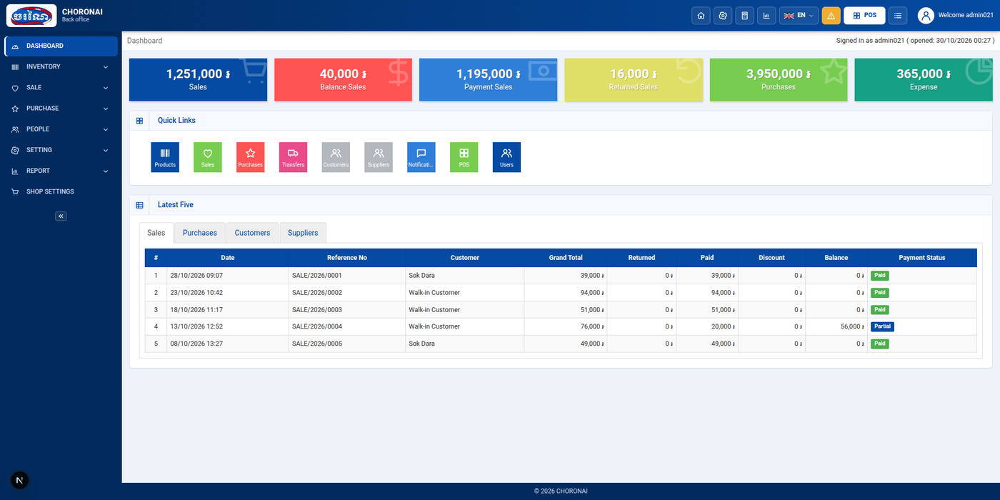
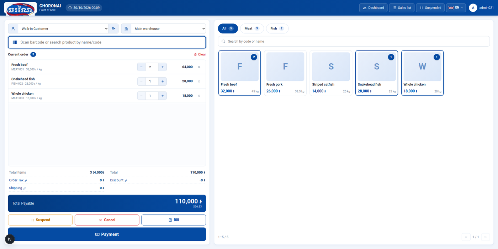
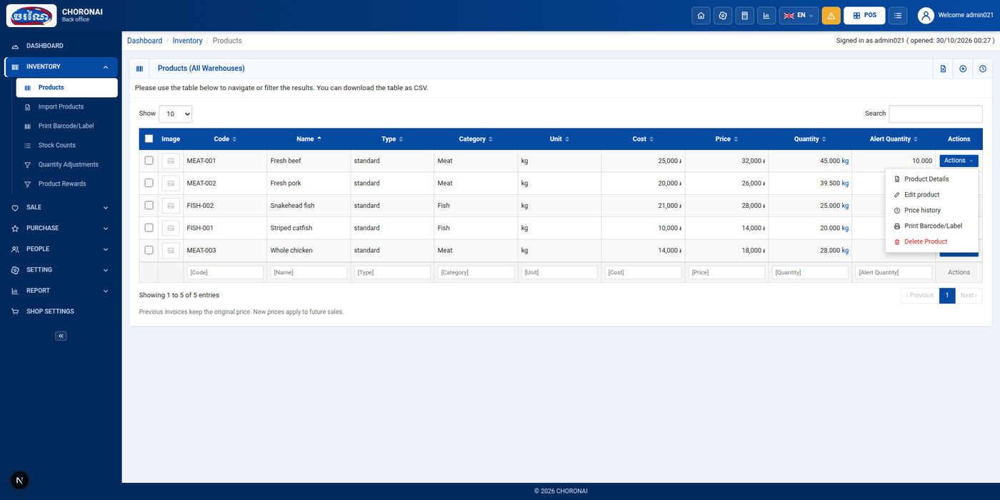

<div align="center">


# Choronai — Shop Management

Inventory, point of sale, purchasing and reports for a meat and fish shop.
English and Khmer (ភាសាខ្មែរ) interface.


</div>

---

## Screenshots

| Dashboard                                    | Point of sale                    |
| -------------------------------------------- | -------------------------------- |
|  |  |
| **Products**                                 |                                  |
|    |                                  |

## Features

- **Point of sale:** barcode/search, product grid by category, cart, discount, tax and shipping, suspend and resume, cash in riel or US dollars with quick-cash buttons, printable bill and receipt.
- **Products:** standard, service and combo products, with images, suppliers, promotions, price history, CSV import/export and barcode label printing.
- **Purchasing:** purchase requests, orders, purchases and returns, plus expenses.
- **Stock:** every sale, purchase, return and quantity adjustment updates stock automatically. Low-stock alerts appear in the header.
- **People:** customers (with award points), suppliers and users.
- **Settings:** system and POS settings, branches, warehouses, categories, units, currencies, tax rates, group permissions, printers and email templates.
- **Reports:** overview, warehouse stock, category and best-seller charts, plus stock in/out, expiry, adjustment and sales reports. All of them can be exported as CSV or printed.
- **Two languages:** switch between English and Khmer from the flag menu in the header.

## Getting started

You need **Node.js 22 or newer**, which comes with npm.

```bash
# 1. Install dependencies
npm install

# 2. Start the development server
npm run dev
```

Then open **http://localhost:3000**. The point of sale is at **http://localhost:3000/pos**.

The first visit shows sample products, sales and customers so every screen has something in it.

## Scripts

| Command                | What it does                                   |
| ---------------------- | ---------------------------------------------- |
| `npm run dev`          | Start the development server with hot reload   |
| `npm run build`        | Create a production build                      |
| `npm start`            | Serve the production build (run `build` first) |
| `npm run typecheck`    | Check TypeScript types                         |
| `npm run format`       | Format all files with Prettier                 |
| `npm run format:check` | Check formatting without changing files        |

> **Using pnpm or yarn?** That works too. Replace `npm run` with `pnpm` or `yarn`.
> The repository includes both `package-lock.json` (npm) and `pnpm-lock.yaml` (pnpm).

## Tech stack

- **[Next.js 16](https://nextjs.org/)**, the React framework, using the App Router
- **React 19** and **TypeScript**
- Plain CSS: no UI library, and charts are hand-made SVG
- Data is stored in the browser's **localStorage** for now (see [Current limits](#current-limits))

## Project structure

```text
src/
├── app/                    Routes (one catch-all route for admin pages, plus /pos)
├── components/
│   ├── layout/             Header, sidebar, language menu, calculator
│   └── ui/                 Box, DataTable, Modal, form fields, tabs, charts
├── config/modules.ts       Every page: sidebar, URL and breadcrumbs in one list
├── data/                   Stored collections and sample data
├── features/
│   ├── dashboard/          Totals, quick links, latest five
│   ├── products/           Product list, add/edit page, import, barcode labels
│   ├── pos/                Point of sale, cart, payment, receipt
│   ├── transactions/       Purchase, return and adjustment forms
│   ├── resources/          Config-driven list pages (customers, units, ...)
│   ├── settings/           System/POS settings, logo, permissions, emails
│   └── reports/            Charts and report tables
├── i18n/                   English and Khmer text
├── lib/                    Storage, formatting, CSV helpers
└── styles/                 CSS (theme.css holds the brand colours)
public/brand/               Store logo
docs/                       Developer guide and screenshots
```

For where to make common changes, see the **[development guide](docs/project-structure.md)**.

## Customising

- **Logo:** in the app, open **Settings → Change Logo**, or replace `public/brand/choronai-mark.png`.
- **Brand colour:** change `--brand` in [`src/styles/theme.css`](src/styles/theme.css).
- **Shop name, prefixes, defaults:** **Settings → System Settings** and **POS Settings** in the app.
- **Text and translations:** [`src/i18n/locales/en.ts`](src/i18n/locales/en.ts) and [`km.ts`](src/i18n/locales/km.ts).

## Current limits

This is a front-end prototype:

- **Data stays in one browser.** It is saved in localStorage and is not shared between devices. Clearing browser data removes it.
- **There is no login yet.** `admin021` is a placeholder user, and group permissions are saved but not enforced.
- **Not connected yet:** barcode graphics on labels, receipt printers, payment gateways (ABA / KHQR) and the weighing scale.
- **Placeholder pages:** Shop Settings, Transfers and Notifications.

The storage layer is isolated in [`src/lib/store.ts`](src/lib/store.ts), so it can be replaced with a real API later.

## Before you commit

```bash
npm run format:check && npm run typecheck && npm run build
```
